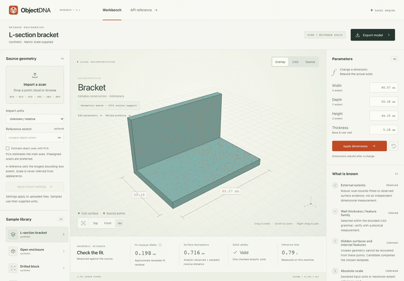
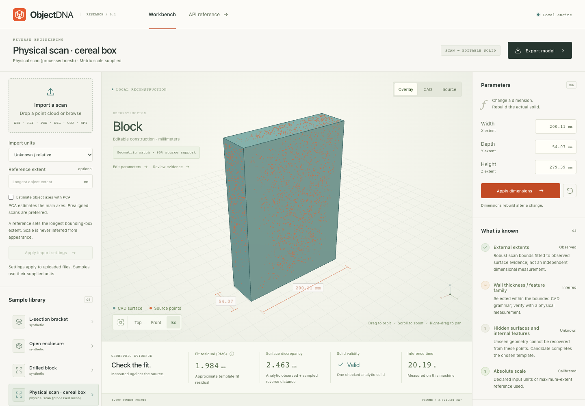
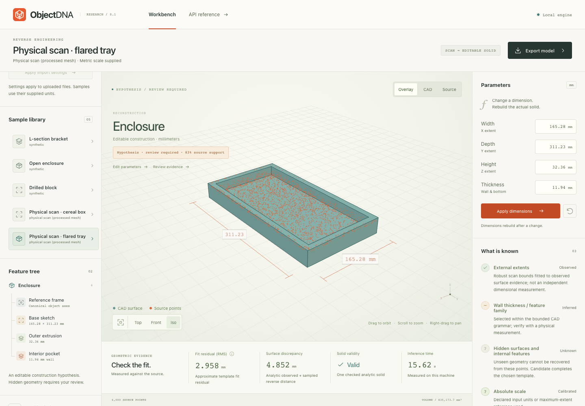

<div align="center">
  
  <h1>ObjectDNA</h1>
  <p><a href="https://github.com/nazeeh111/ObjectDNA/actions/workflows/ci.yml"></a></p>
  <p><strong>From scan evidence to editable CAD.</strong></p>
  <p>A local 3D workbench for simple engineering parts, with learned parameter proposals,<br/>explicit uncertainty, and analytic STEP export.</p>
  <p><a href="#quickstart">Quickstart</a> · <a href="docs/assets/walkthrough.mp4">Watch the demo</a> · <a href="results/EXPERIMENTS.md">Experiments</a> · <a href="docs/ARCHITECTURE.md">Architecture</a></p>
</div>

[](docs/assets/walkthrough.mp4)

ObjectDNA fits **prealigned brackets, open enclosures, and drilled blocks** from point clouds or scanned meshes. Inspect the source/CAD overlay, change dimensions, rebuild the actual solid, and export STEP, STL, CadQuery source, or the evidence record. All fitting runs locally on the CPU. No account, API key, cloud inference, or paid service is required.

**This release is bounded.** It reconstructs a construction hypothesis within three supported shape families. It does not recover arbitrary objects, hidden structure, materials, tolerances, or mechanical function. The optional photo bridge is unverified end to end; the workbench imports reconstructed geometry, not photos directly.

The [silent walkthrough](docs/assets/walkthrough.mp4) records the real application: reconstruction, overlays, dimension edits, a physical-scan import, STEP export, and a failure case. It samples browser frames at 4 fps and is not a runtime benchmark.

## Quickstart

Use **Python 3.12**. The repository includes a prebuilt workbench, trained numeric weights, and sample scans; Node is only needed to rebuild the frontend.

```bash
git clone https://github.com/nazeeh111/ObjectDNA.git
cd ObjectDNA
python3.12 -m venv .venv
source .venv/bin/activate
python -m pip install -r requirements-tested.txt
python -m pip install --no-deps -e .
objectdna serve
```

Open [**http://127.0.0.1:8768**](http://127.0.0.1:8768). The tested environment is Apple Silicon macOS, Python 3.12.13, and CadQuery 2.6.1. Python dependencies download during installation; inference itself needs no network connection. On Windows, activate the environment with `.venv\Scripts\Activate.ps1`; Windows execution is not yet verified.

Prefer `uv`? Replace the environment/install commands with `uv venv --python 3.12`, activation, `uv pip install -r requirements-tested.txt`, and `uv pip install --no-deps -e .`. The [portable wheel](https://github.com/nazeeh111/ObjectDNA/releases/download/v0.1.0/objectdna-0.1.0-py3-none-any.whl) includes the same workbench, models, and samples; install it after the tested requirements instead of the editable package.

CadQuery's native dependencies can make the first import slow. Later requests reuse the running process. Use `objectdna serve --port 8770` if port 8768 is occupied. The server binds to loopback and is intended for local workstation use.

### Reconstruct, inspect, edit

1. Start with a labeled synthetic fixture or the licensed cereal-carton scan. The porcelain tray is an intentional outside-grammar example.
2. Import your scan with known units, or provide its measured **maximum bounding-box extent** in millimetres. Unknown scale stays explicit and blocks metric CAD export.
3. Compare source points and CAD, inspect residuals and unsupported surfaces, then edit dimensions and rebuild. A dimension edit supplies design intent; it is not a new measurement.
4. Export the model and keep its evidence record. STEP preserves analytic geometry; CadQuery source and parameter JSON preserve editable construction intent.

| Capability | Verified scope |
| --- | --- |
| Input | XYZ, CSV, PTS, ASCII PCD, PLY, STL, OBJ, and numeric NPY; bounded, data-only parsing |
| CAD families | Orthogonal brackets, uniform-wall open enclosures, and blocks with Z-axis bores |
| Workbench | Source/CAD overlay, orbit and zoom, dimension edits, operation tree, evidence and unknowns |
| Output | Validated STEP/STL, editable CadQuery source, and JSON evidence |
| Scale and pose | Declared units or maximum-extent calibration; prealignment recommended, approximate PCA optional |
| Photos and video | External helper scripts only; bundled multi-view inference is not validated |
| Assemblies and complex features | Outside scope: parts, threads, fillets, arbitrary surfaces, and hidden cavities |

For batch use, choose a new output folder:

```bash
objectdna fit data/synthetic/bracket.xyz --units mm --out my-bracket
objectdna fit data/real/cereal_box.xyz --units mm --out cereal-envelope

# The measured compact learned-proposal path
objectdna fit data/synthetic/enclosure.xyz --units mm \
  --candidate-mode learned_compact --ranking geometric --out my-enclosure
```

Existing export folders are preserved. Dense proposals with geometric scoring remain the default; compact learned proposals are selectable in the workbench and CLI. Both use numerical refinement unless disabled.

## What the learning contributes

ObjectDNA trains two small components on original procedural parts. No upstream pretrained neural checkpoint is bundled.

- **Thickness proposals:** a 102 → 48 → 24 → 1 neural network proposes wall thickness for each competing family. In compact mode, three nearby thicknesses replace dense search. A 60-object, known-family development test measured **0.386 mm MAE**, versus **1.544 mm** for the training-median ratio baseline. This is a component result, not full reconstruction accuracy.
- **Evidence ranking:** a separate pairwise logistic ranker learns from approximate template residuals, coverage, orthographic raster feedback, and operation complexity. It reduced geometric accuracy in the held-out tests below, so it remains experimental and is not the default.

Both components have inspectable JSON weights and recorded training seeds. Geometry scoring, bounded least-squares refinement, and CadQuery solid validation remain explicit. See the [proposal card](models/PROPOSAL_CARD.md), [ranker card](models/MODEL_CARD.md), and [research context](docs/research.md). The proposal optimizer reached its fixed iteration limit; convergence is not claimed.

## Measured results

**48 new synthetic objects**, held out from training and development, with the design fixed before this test. All methods use the same supported grammar, block/bore proposals, geometric evidence, and refinement. They are not comparisons against upstream neural reconstruction systems.

| Method | Volume IoU ↑ | Chamfer, mm ↓ | Extent MAE, mm ↓ | Initial proposals ↓ | Valid / editable solids |
| --- | ---: | ---: | ---: | ---: | ---: |
| Dense proposals + geometric score | 0.928 | 0.869 | 0.368 | 23.71 | 48/48 |
| **Compact learned proposals + geometric score** | **0.929** | **0.869** | **0.366** | **7.25** | **48/48** |
| Compact proposals + learned ranker | 0.925 | 0.878 | 0.417 | 7.25 | 48/48 |

Compact search generated **69.4% fewer initial proposals**, or **61.6% fewer total scored candidates** including refinement, with similar aggregate shape accuracy on this set. A separate warmed, single-thread repeat measured **0.105 s compact versus 0.177 s dense**, a **1.68×** speedup (ratio of mean per-object median runtimes), with exploratory paired bootstrap 95% interval 1.60–1.76×. This excludes cold import, CAD validation/export, and UI latency. See the [quality report](results/compact-test-v2/REPORT.md) and [timing protocol](results/timing-v2/REPORT.md).

Chamfer is the mean unsquared symmetric nearest-neighbor distance between independent 7,000-point surface samples; its mean same-solid sampling floor was 0.783 mm. IoU uses 50,000 Monte Carlo points. Extent error compares generated width, depth, and height. Editability means a successful 10% width change with dimensional readback. These metrics establish neither real-world dimensional accuracy nor a significant accuracy improvement from compact search.

**Failures are part of the result.** Dense and compact geometric modes selected the correct family on 47/48 objects; correct family plus bore count succeeded on 12/16 true blocks. The worst compact case had IoU 0.775. The learned ranker also underperformed geometric scoring in the [first held-out experiment](results/synthetic-v1/REPORT.md), with mean IoU 0.921 versus 0.928. That negative result and its frozen source are retained. The [experiment index](results/EXPERIMENTS.md) explains the splits, ablations, per-case outcomes, and replay evidence.

### Physical capture, without invented ground truth

| Cuboid-envelope fit | Outside-grammar failure |
| --- | --- |
|  |  |
| Cereal carton: **1.984 mm** fitting residual RMS, **2.678 mm** sampled scan/CAD Chamfer. | Flared tray: **2.958 mm** fitting residual RMS, **5.077 mm** sampled scan/CAD Chamfer; support gate rejects the hypothesis. |

The fitting residual combines primitive-shape distances and is not the exact shortest distance to the final surface everywhere. Sampled scan/CAD Chamfer is measured separately.

These points derive from processed physical scans in **Google Scanned Objects, Copyright 2020 Google LLC., [CC BY 4.0](https://creativecommons.org/licenses/by/4.0/)**. They are samples of published meshes, not raw sensor captures. The cereal model is an outer-envelope hypothesis; shell thickness, contents, and hidden construction are unknown. The tray's flared walls and feet do not fit a uniform-wall enclosure.

There is **no independent caliper truth or ground-truth CAD** for these examples. Real dimensional error and volumetric IoU are unknown. Source links, exact hashes, and transformations are in [scan provenance](data/real/README.md); exports and measurements are in the [real demonstration report](results/real-v1/REPORT.md).

## Reproduce and extend

The [experiment index](results/EXPERIMENTS.md) links training manifests, object-disjoint splits, original negative results, frozen source/model snapshots, and measured timing. The tested dependencies are pinned in `requirements-tested.txt`.

```bash
pytest -q
python scripts/benchmark.py --out runs/my-synthetic-run
python scripts/real_demo.py --out runs/my-real-run
```

To retrain both components and evaluate the new weights explicitly:

```bash
python scripts/train_proposal.py --output runs/models/proposal.json
python scripts/train.py --output runs/models/ranker.json
python scripts/benchmark_compact.py --split test --models runs/models \
  --out runs/compact-test-v2
python scripts/benchmark_timing.py --models runs/models \
  --quality-report runs/compact-test-v2/summary.json --out runs/timing-v2
```

Research scripts write fresh `runs/` outputs and reject existing targets. Omit `--models` to evaluate the bundled release weights; pass a directory containing both model JSON files to evaluate your own. Timing requires the same models used by its quality report.

`python scripts/fetch_real.py --out runs/real-scans` recreates the two CC BY 4.0 scan derivatives from versioned, hash-checked archives. `python scripts/generate_samples.py --out runs/synthetic-samples` regenerates the explicitly synthetic fixtures. Numerical training and evaluation run on the CPU. Same-environment replay is verified; cross-platform bitwise reproduction is not claimed.

To rebuild and check the workbench, use **Node 22.12+** and installed Google Chrome:

```bash
cd web
npm ci
npm run build
# With objectdna serve running in another terminal:
npm run test:ui
```

See [validation evidence](docs/VALIDATION.md), [architecture and coordinate conventions](docs/ARCHITECTURE.md), and [contribution guidance](CONTRIBUTING.md). The [CI workflow](.github/workflows/ci.yml) configures Python tests, the frontend build and portable-wheel verification on Linux and macOS. Linux also runs the browser workflow and WCAG-tagged automated accessibility checks; the targeted mobile capture check is separate.

## Optional image reconstruction

`scripts/extract_frames.py` extracts video frames with FFmpeg. `scripts/vggt_to_scan.py` accepts separately installed VGGT and locally supplied weights, producing relative XYZ points without automatically downloading checkpoints or accepting licenses. Its end-to-end inference is not verified. Crop the object, inspect the reconstructed geometry, and calibrate scale before metric export.

The measured contribution here is **bounded search efficiency from learned parameter proposals**. Geometric candidate selection and refinement have substantial prior art; no first-use or state-of-the-art claim is made. The next validation needs independently measured physical brackets, enclosures, and machined blocks, followed by verified multi-view reconstruction.

## License and citation

Original ObjectDNA source, procedural data, and trained weights use the [MIT license](LICENSE). Bundled Google scan derivatives remain CC BY 4.0. Third-party dependencies and optional upstream checkpoints retain their own licenses; see [third-party notices](THIRD_PARTY_NOTICES.md) and the [code/weight/data license matrix](docs/UPSTREAM_LICENSES.md).

Use the repository's [citation metadata](CITATION.cff) when citing this software, and cite upstream methods separately when using them.
