# Architecture

ObjectDNA keeps observations, reconstruction hypotheses, and user design intent distinct.

```mermaid
flowchart LR
  A[Point cloud or mesh] --> B[Validate / units / calibration]
  P[Optional external VGGT photo stage] -. relative points .-> B
  B --> C[Robust bounds / optional PCA]
  C --> D[Geometric feature and bore evidence]
  C --> N[Learned thickness network]
  N --> E[Bounded CAD candidates]
  D --> E
  E --> R[Geometry and silhouette evidence]
  R --> L[Inspectable pairwise ranker or fixed score]
  L --> F[Bounded signed-distance refinement]
  F --> K[Exact CadQuery solid validation]
  K --> W[3D workbench / dimension edits]
  W --> X[STEP + STL + editable source + evidence]
```

## Modules and contracts

- `geometry.py`: analytic fitting geometry, independently tested against exact kernel occupancy and faces; procedural shapes and noisy/missing-side acquisition.
- `proposal.py`: 102-feature coordinate-histogram neural network, two hidden layers, one bounded wall-thickness output, numeric JSON weights. It proposes parameters for each candidate family, not a measured truth or unrestricted CAD program.
- `inference.py`: candidate generation; normalized surface, coverage, orthographic-raster and complexity features; pairwise linear ranking; bounded robust least-squares refinement; heuristic support gate and explicit unknowns.
- `cad.py`: finite numeric schema, constrained authored CAD operations, exact valid single-solid construction, mesh tessellation and export. Generated Python is authored from validated values. Uploaded programs are never executed.
- `io.py`: bounded data-only imports, checked NPY header before allocation, finite XYZ validation, mesh sampling and parser error normalization.
- `api.py`: loopback-only FastAPI workbench, same-origin mutation checks, 24 immutable session results in memory, serialized exact-kernel work, bounded imports and temporary downloads.
- `web/`: local Vite/Three.js workbench, actual point/mesh overlays, live parameter edits and diagnostics. No runtime CDN or account is needed.

## Coordinate convention

Millimeters for known units or explicitly supplied calibration. A canonical lower corner anchors X width, Y depth and Z height. Bracket's rear upright occupies Y=0..thickness. The enclosure has uniform walls and bottom, open at +Z. Drilled-block bores run along Z. Default inputs should be aligned to this frame. Optional PCA alignment is approximate and may swap or flip axes. The evidence manifest retains the source-to-canonical transform.

Unknown-unit scans are normalized to a 100-unit maximum extent for preview. STEP/STL/Python metric export remains blocked until the user supplies known units or a reference maximum extent. A reference is a bounding-box extent, not an arbitrary distance between picked points.

## Evidence is separate from validity

A valid CAD solid establishes that the modeled operations form a valid solid. It does not establish that the selected shape matches the physical object. Fit support and reverse coverage are heuristics, not calibrated probability or tolerances. Inference's hybrid surface discrepancy is approximate analytic CSG fitting residual plus sampled reverse distance; published benchmark Chamfer uses independent sampled surfaces and states its convention and sample floor.

Outer surfaces have observational support. Template choice, wall uniformity, and through-bore completion are inferred. Unseen cavities, threads, fillets, materials, functional interfaces, loads and manufacturing tolerances are unknown. Editing a dimension supplies design intent and recomputes residuals; it does not create a new measurement.

## Local runtime and boundaries

No paid APIs, remote inference, uploads, telemetry, credential storage or model-generated code execution. This is a local workstation tool, not a hardened multi-tenant service. Do not expose the server publicly. Maximum import size is 25 MiB, input point count 200,000, fitting points 6,000, holes 16 and session history 24 results. Exact operations are serialized because kernel behavior across concurrent requests must not be assumed safe.

STEP preserves analytic geometry; CadQuery/Python and parameter JSON preserve editable construction intent. Fresh-process STEP readback uses the same kernel and is not an independent CAD-system interoperability result.
