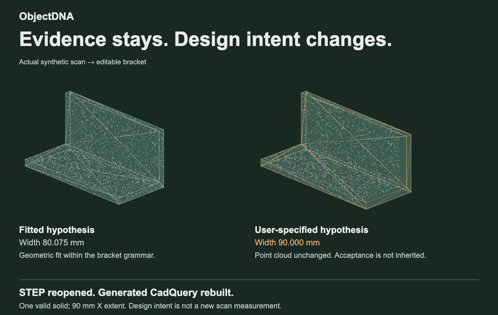
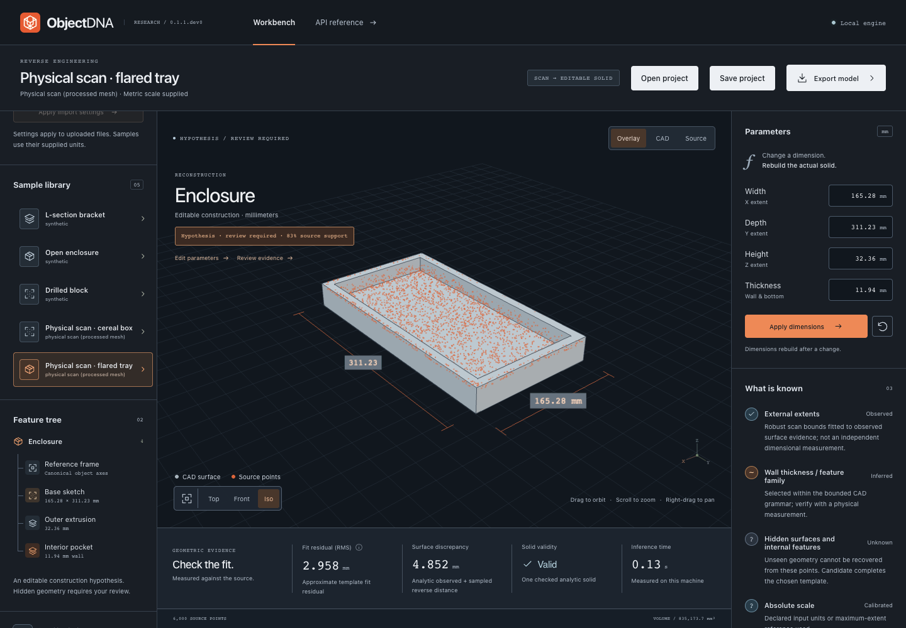

# An edit is intent, not another measurement

This actual local ObjectDNA journey starts with the bundled, explicitly synthetic bracket. The known-family construction hypothesis fits the prealigned points; an intentional width change then produces a different valid solid. The source cloud stays fixed. The workbench correctly withdraws acceptance after editing.



[Open the full desktop workspace](edited-workspace.png) · [Phone workspace](edited-workspace-mobile.png) · [Download the complete recorded example](worked-example.zip) · [Editable saved project](edited-project.json)

## Scan evidence and a construction hypothesis

The current public source `3809e47e6d3c6efc4be4ec457c1075d81f5db59f` ran locally on Python 3.12.13 with the exact tested dependency pins, including CadQuery 2.6.1. The actual browser chose the synthetic bracket fixture with known millimetre scale, dense proposals, geometric ranking and refinement. The frame is prealigned, with X width, Y depth and Z height. No new training, private scan, provider or expensive study was used.

The original fixture has 2,400 points; normalization retained 2,392 and recorded eight removed points. The initial fitted width was **80.0747208474 mm**, against a procedural nominal width of 80 mm. This is one synthetic fixture, not a new accuracy estimate. Approximate analytic CSG residual RMS was **0.1982047634 mm**. That residual is not caliper error, exact shortest-surface distance or physical reconstruction accuracy. Full points, transform, proposal identity, mesh and diagnostics are retained in [initial evidence](initial-evidence.json).

The figure projects all 2,392 retained points and the actual tessellated CadQuery solids with one orthographic projection and a common scale across panels. It is a source-derived explanation, not an app screenshot. No points were hidden to improve the fit. Its [standard-library generator](figure.py), [editable desktop SVG](scan-to-edit.svg) and [phone SVG](scan-to-edit-mobile.svg) remain available.

## Change a dimension, keep the distinction

In the actual workbench, editing width to **90 mm** rebuilt one valid solid while preserving depth 50.1819662478 mm, height 44.1476518298 mm and thickness 5.1812281820 mm. The source points remained byte-for-byte equal as numeric arrays. Acceptance became false, and the interface labeled the result a hypothesis. Edited residual RMS rose to **0.3204104230 mm**. The edit supplies design intent; it is not a better measurement or a newly supported reconstruction.

[Edited evidence](edited-evidence.json) and the [execution record](journey.json) preserve that before/after distinction. Neither a valid OpenCascade solid nor a small residual establishes manufacturability, materials, tolerances, mechanical function or hidden construction.

## Export, close, and independently rebuild

**Save project** downloaded the bounded data-only project. A fresh browser context opened it and recomputed the model: exact current parameters and all retained points matched, and acceptance remained false. A malformed project was rejected while preserving the previous valid model. Escape closed the export dialog and restored focus to its opener. Desktop 1440×1000 and phone 390×844 actual workspace captures are retained; the phone has no horizontal overflow.

The actual export dialog downloaded [STEP](edited-bracket.step) and [CadQuery Python](edited-bracket.py). CadQuery reopened the STEP as **one valid solid**, with bounds **90 × 50.1819662478 × 44.1476518298 mm** and volume **41,570.8335094 mm³**. The generated Python executed in a fresh temporary directory; its newly emitted STEP reopened with the same bounds and volume. [Exact export verification](export-check.json).

The saved project preserves normalized points, scale/transform metadata, provenance and inference/edit history. The STEP preserves analytic geometry. The Python preserves the current parametric construction. Neither is a substitute for the original scan. Project digests detect accidental changes; they are not signatures or authenticated provenance.

To repeat with the installed current source and a new output directory:

```sh
objectdna project-open docs/presentation/edited-project.json
objectdna project-export docs/presentation/edited-project.json --format step --out reopened.step
python docs/presentation/edited-bracket.py
# Run the Python in a fresh working directory: it emits objectdna.step and objectdna.stl.
```

The [ZIP](worked-example.zip) includes every recorded source/evidence/model file named by its own verification record. Extract into a fresh directory and read its `README.md`. Do not execute untrusted downloaded Python; this example's source consists of the repository's inspectable numeric CadQuery construction.

## A valid solid can still be the wrong hypothesis

The same session selected the licensed porcelain-tray sample. Its flared walls and feet fall outside the uniform-wall enclosure grammar. ObjectDNA produced a valid solid but rejected support: acceptance false, with explicit low-evidence and unknown-accuracy warnings. This is retained as a real failure boundary, not concealed by the successful bracket.



[Exact tray evidence](outside-grammar.json). This sample derives from Google Scanned Objects, Copyright 2020 Google LLC, CC BY 4.0. It is a processed published mesh, not a raw sensor capture; independent physical dimensional truth is absent. Exact upstream identity and transformations remain in [scan provenance](../../data/real/provenance.json) and [licenses](../UPSTREAM_LICENSES.md).

## Scope and provenance

ObjectDNA supports only prealigned orthogonal brackets, uniform-wall open enclosures and drilled blocks with Z-axis bores. Optional PCA may swap or flip axes. Unknown scale blocks metric exports. Arbitrary surfaces, threads, fillets, assemblies and unseen features remain outside scope. See the complete [setup and methods](../../README.md), [architecture](../ARCHITECTURE.md), [validation](../VALIDATION.md) and existing frozen [experiments](../../results/EXPERIMENTS.md).

This work adds presentation and reproducible example artifacts. The expert workspace, inference, trained weights, source inputs and export implementation remain unchanged. Original source and synthetic assets are MIT. CadQuery/OpenCascade and other dependencies retain their own licenses; processed Google data remain CC BY 4.0. No new algorithm, physical accuracy, model convergence or fabrication-readiness claim is introduced.
